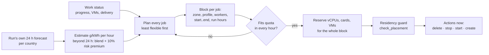
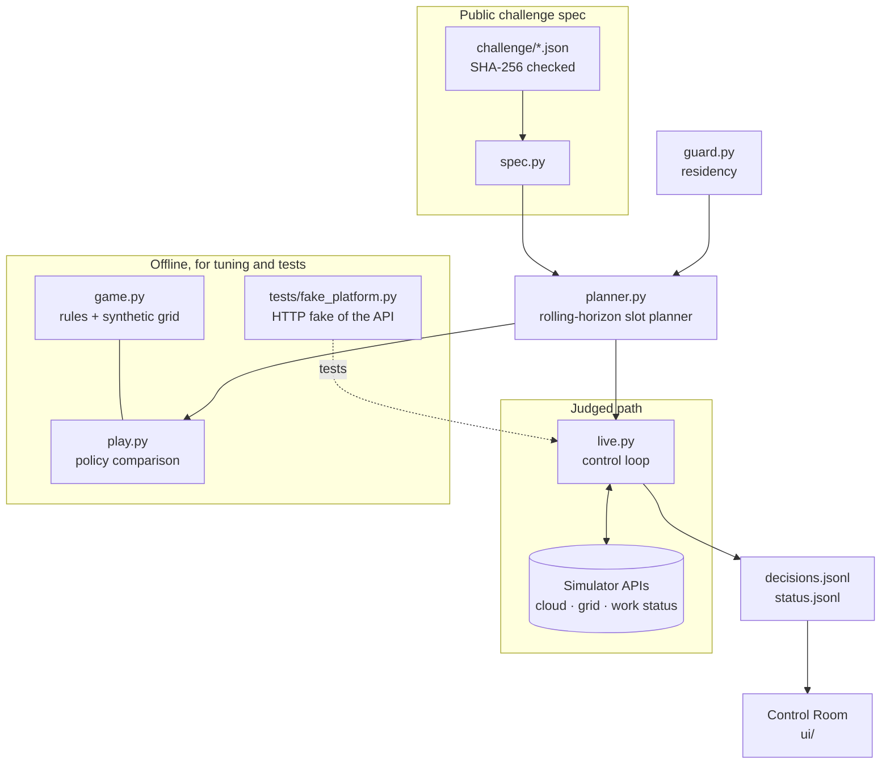

# GreenOps Orchestrator · Team CryptoNight

**Carbon-aware cloud orchestration for the Exoscale GreenOps Challenge**
TEB AI Hackathon: Critical Infrastructure & Energy Security · weXelerate, Vienna · 23–25 October 2026

[](https://github.com/ValGSgit/TEB-AI-Hackathon-Critical-Infrastructure-and-Energy-Security/actions/workflows/tests.yml)

> Same work, same deadlines, same legal countries: **46% less carbon** than a naive scheduler
> (offline benchmark, 8 synthetic grids, 15/15 delivered on time in every run).
> Twelve practice runs on the live platform, all qualified. Every failure we hit became a rule and a test, and the
> latest runs deliver 15/15 with every VM deleted within minutes of its delivery.

**Project site: [valgsgit.github.io/TEB-AI-Hackathon-Critical-Infrastructure-and-Energy-Security](https://valgsgit.github.io/TEB-AI-Hackathon-Critical-Infrastructure-and-Energy-Security/)**, with an interactive 120-hour replay, the
planner explained, results, the Control Room and the Earth view.

---

## Contents

1. [The problem](#1-the-problem)
2. [How we save carbon](#2-how-we-save-carbon)
3. [How the planner works](#3-how-the-planner-works)
4. [Results](#4-results)
5. [Rules we never break](#5-rules-we-never-break)
6. [Architecture](#6-architecture)
7. [Run it](#7-run-it)
8. [Submission](#8-submission)
9. [Presentation assets](#9-presentation-assets)
10. [Also in this repo](#10-also-in-this-repo)

---

## 1. The problem

A simulated European cloud must finish **15 workloads** (11 CPU, 4 GPU) within **120 simulated hours**. Our
program is the operator: through an Exoscale-compatible API it decides **where** each job runs, **on which
hardware**, **when** it runs and **when to stop or delete** its machines.

| Constraint | Value |
| --- | --- |
| Zones | 11 data centres in 8 countries (AT, BG, CH, DE, ES, FR, HR, IT), PUE 1.20 – 1.52 |
| Hardware | 22 VM profiles: 4 CPU sizes, 18 GPU profiles in 6 families (V100, A40, A30, RTX A5000, RTX 3080 Ti, RTX PRO 6000) |
| Quota | 20 VMs, 320 vCPUs, GPU cards capped per family (RTX PRO 6000: 4 cards) |
| Work | 14,600 vCPU-hours of CPU work plus 4 GPU jobs (up to 124 million TFLOP each) |
| Data residency | Each job has allowed countries. **One attempt in a wrong country disqualifies the whole run**, even if the API rejects it. Switzerland is not EU. |
| Information | Only the run's own electricity forecasts (6 or 24 h ahead) and its published observations |
| Judging | Organizers rerun our container at 720× with fresh credentials: 2 CPUs, 1 GiB RAM, read-only root, 15 min |

**Score (greenops-score-v2, electricity only).** We confirmed this formula against the platform's
per-workload breakdown; it reproduces every workload's points to four decimals:

```
max_i  = 20,000 × ref_i / Σ ref                     ref_i = fixed reference energy (kWh) per workload
L_i    = carbon_i / (ref_i × 200 g/kWh)             this workload's carbon cost
S      = Σ carbon / (Σ ref × 200 g/kWh)             run-wide carbon cost (idle VMs count here)
points = Σ max_i × progress_i / (1 + 0.75·L_i + 0.25·S)   + 5,000 if all 15 are delivered on time
```

So every gram counts twice: once for the job that burned it and once in the run-wide term every job shares.
Missing one deadline costs the whole 5,000 bonus, more than a good run loses to carbon in total, so
**on time is a hard constraint, carbon is the objective.**

## 2. How we save carbon

```
carbon (g) = power (kW) × hours × PUE × grid intensity (g CO₂e/kWh)
             └ hardware ┘ └ work ┘ └ site ┘ └──── where and when ────┘
```

Every term is a lever, and each one is a decision the orchestrator makes:

| Lever | What we do | Why it matters (catalog numbers) |
| --- | --- | --- |
| **Where** | Run each job in the legal zone with the lowest PUE × forecast intensity | Grid intensity differs several-fold between countries; PUE alone adds up to 27% (1.20 vs 1.52) |
| **Which hardware** | Pick the most energy-efficient allowed profile; add workers only when a deadline forces it | CPU: mega uses 2.90 Wh per vCPU-hour, titan 3.32 (+14%). GPU: A30 0.24–0.32 J per TFLOP, RTX PRO 6000 0.44, A40 0.55, RTX 3080 Ti 1.08, V100 2.0–2.2 (up to 9×). Each extra worker adds sync overhead (5–8%) |
| **When** | Run in the cleanest forecast hours, **stop** the VM through dirty hours | A stopped VM draws nothing and keeps all its work and staged input; intensity moves hour by hour with solar and wind |
| **Clean up** | Delete VMs the moment the final output is delivered | Undeleted VMs draw idle power until the end of the run, and it all lands in the shared term |

The catch: **a stopped VM still holds its quota.** Pausing one job can starve another of vCPUs or GPU cards
and make it miss its deadline. Our first, per-job pausing rule did exactly that (only 9–12 of 15 jobs were on
time offline). The planner below plans all jobs together on a shared quota calendar.

## 3. How the planner works

Every simulated hour, `planner.py` re-plans all unfinished jobs on an hourly grid up to hour 120:



1. **Cost of an hour** for job *j* in zone *z*: kW (profile × workers) × PUE(*z*) × estimated g/kWh.
   Inside the 24-hour forecast that is the forecast. Beyond it, a blend of the same hour and the forecast
   mean, plus a 10% premium, so known clean hours win over guesses.
2. **Blocks.** Each job gets a block `[start, end)` between 1× and 2× its run time. It **runs in the
   cleanest hours inside the block** and is stopped in the others. Quota is reserved for the whole block,
   because stopped VMs keep their quota.
3. **Order.** Jobs that are already running are planned first, then the rest from least to most spare time,
   so the tightest jobs get quota first. Every job aims to finish 2 h before its deadline.
4. **Placement** (zone, profile, workers) is chosen when a job is first planned, only among zones the
   residency guard allows, with faster worker counts as fallbacks when time or quota is tight.
5. **Act.** Delete after `final_output_delivered`, stop, start, create. The first create starts the run
   clock. Refused actions are re-planned. Every decision is logged with its reason
   (`decisions.jsonl`), which feeds the Control Room.
6. **Safety nets from the practice runs** (`docs/context/decisions.md`, ADR-0012 to ADR-0017):
   - no job may starve: a job with no slot, or only a late one, is planned first;
   - finish what is nearly done, and stop pausing when spare time runs low;
   - pause less when the platform answers slowly;
   - the live loop never sits blind: deletes first, parallel actions and forecasts, a stale-forecast
     fallback, safe mode, 60 s status timeout.
7. **Profiles** (`GREENOPS_PLANNER`): **`adaptive` is the default**, and what the image runs when nothing is set.
   It plans like our best run while the platform answers quickly, and switches the stall rules on by itself
   once a gap between status replies exceeds 0.75 simulated hours. `safe` keeps every rule always on.
   Nothing is tuned to one scenario.

Example: a job that needs 7 run hours gets a 10-hour block (R = running, · = stopped; quota is held for all
10 hours):

```
hour        30   31   32   33   34   35   36   37   38   39
forecast   210  180  140  120  150  230  260  190  130  110   g/kWh
job          ·    R    R    R    R    ·    ·    R    R    R    the 7 cleanest hours run, the 3 dirtiest wait
```

## 4. Results

### Offline benchmark (reproducible: `python -m greenops.play --seeds 8`)

The offline game in `greenops/game.py` implements the published rules (boot, input per worker, sync overhead,
stop/resume, output, idle draw until delete, quotas, residency disqualification) and the score formula above.
Electricity is **synthetic**: 8 random grids built from generic country profiles, never the scenario's data.

| Policy (added one lever at a time) | Carbon (mean ± sd) | vs naive | Energy | GPU carbon | Score | On time |
| --- | --- | --- | --- | --- | --- | --- |
| Naive: first legal zone, fastest profile, start at release | 24.63 ± 0.77 kg | – | 124.4 kWh | 15.13 kg | 20,323 | 15/15 |
| + **where** and **which hardware** | 14.10 ± 0.42 kg | **−43%** | 107.2 kWh | 8.46 kg | 21,889 | 15/15 |
| + **when** to start | 14.07 ± 0.42 kg | −43% | 106.9 kWh | 8.46 kg | 21,894 | 15/15 |
| + **stop through dirty hours** (full planner, `adaptive`) | **13.35 ± 0.45 kg** | **−46%** | 107.9 kWh | 7.94 kg | **22,013** | **15/15** |

- Average grid intensity of the electricity used drops from 198 to 124 g/kWh, and energy drops 13%.
- Every policy delivers 15/15 on time on all 8 grids, with no lost work and no residency violation.
- Placement and hardware choice are the biggest lever; pausing adds a further 5% on top. With the stall
  rules always on (`safe` profile) the planner gives up about 0.3%; `adaptive`, the default, turns them on
  only when the platform is measured slow (ADR-0017, ADR-0018). On the real
  platform's grids the timing levers are worth more than on our synthetic ones.

### Live platform (practice runs)

| Run | On time | What it showed, and what we changed |
| --- | --- | --- |
| 1 (360×) | 15/15 | Topped the preliminary leaderboard. One crash on a timestamp format: fixed and restart-tested |
| 2 (720×, Docker) | 15/15 | Our best score; the tightest job finished only 1.9 h early |
| 3 | 14/15 | A 10-worker job looked flexible and never got quota → no job may starve |
| 4 | 15/15 | That fix started parallel jobs too early (more carbon) → run 2's job order back |
| 5 | 14/15 | A 65 s platform reply left a nearly done job paused → finish what is nearly done |
| 6 | 14/15 | Forecast timeouts stopped planning → stale-forecast fallback, safe mode, parallel actions |
| 7, 8 | 15/15 | All safety rules on: reproducible within 8 points, ~0.6% below run 2 |
| 9 | 15/15 | `adaptive` profile: within 0.05% of run 2, with every safety net on |
| 10 | 15/15 | `adaptive` again: same behaviour as run 9 (tightest job 2.0 h early, every VM deleted within 0.3 h) |
| 11 | 15/15 | The submitted image and command, nothing set: one slow reply switched the stall rules on; within run-to-run noise |
| 12 | 15/15 | The submitted image and command again: our claimed run, and the best of the submitted code |

All runs stayed qualified, with no residency attempt. Speeds are 720× in our Docker image unless noted.
Real-run carbon and scores stay on the platform dashboard, not in git, because the rules forbid committing
a scenario's real carbon values.

### Fits the judging box

Inside the judges' limits (2 CPUs, 1 GiB, read-only root, `/tmp` only): about 38 MiB of memory in a live
practice run (docker stats). Planning took at most 0.23 s per poll in our logged live polls; the rest of a
slow poll was waiting for the platform. Against the fake platform with 0.3 s per forecast request, a full
run takes 28 s of wall time with parallel forecast fetching, against 160 s without.

### Tests

102 tests (`python -m pytest -q`, about 2 min), run in CI on every push:

| Area | What is tested |
| --- | --- |
| Residency | Every workload × all 11 zones; EU never includes CH; forbid list beats allow list; an adversarial planner fed only illegal zones raises before any create; the live client checks before any HTTP call |
| Information rule | The planner's only electricity input is the forecast callable; horizons are 6 or 24 h; the beyond-forecast formula |
| Scheduling | Full offline runs are legal, on time, cleaner than naive; deletes only after delivery; adoption of existing VMs after a restart |
| Live client | End to end against an HTTP fake of the API: no request leaves the run's URL prefix, endpoint checks, forecast alignment |
| Data contract | Vendored spec matches the organizers' SHA-256 manifest; units (tflop/s → per hour); UI export schema |

## 5. Rules we never break

| Rule | How the code enforces it |
| --- | --- |
| **Residency** (one wrong attempt = disqualified) | `guard.resolve_residency` turns ANYWHERE / EU / country + allow / forbid lists into a country set. `guard.check_placement` runs in the planner **and** again in `Live.create` before any HTTP call. A violation stops the controller instead of being retried. |
| **Forecasts only** | The planner receives one function, `forecast(area, now)`, backed by the run's own grid API. No actuals, no other runs, no stored series. The offline grid is synthetic and lives only in `game.py`. |
| **No credentials in git** | Keys come from the environment or git-ignored files (`greenops-exo.json`, `.env`, `greenops/.local/`). |
| **Stay inside the run** | Endpoint checks and a run-only HTTP adapter (from the starter kit) refuse any URL outside `/runs/{id}/`. Requests are rate-limited under the published limits. |
| **Never lose work** | VMs are deleted only after `final_output_delivered`. After a crash, a restart adopts the existing VMs. Creates use deterministic names, so a retry can't duplicate a VM. |

## 6. Architecture



```
.
├── README.md                     ← you are here
├── docs/
│   ├── context/                  architecture, decisions (ADRs), glossary, workflow, known issues
│   └── greenops-challenge-brief.txt   the organizers' challenge text
├── greenops/                     ★ the submission
│   ├── Dockerfile                judged image: python -m greenops.live
│   ├── challenge/                organizers' public spec (catalog, workloads, rules, manifest)
│   ├── greenops/
│   │   ├── spec.py               load the spec → zones, profiles, workloads, quotas, score constants
│   │   ├── guard.py              residency resolution and the placement guard
│   │   ├── planner.py            the scheduler (blocks, run hours, quota calendar, decision log)
│   │   ├── live.py               entry point against the real API (probe, run, restart-safe)
│   │   ├── game.py               offline game with the published rules, synthetic grid, exact score
│   │   ├── play.py               naive vs +zone vs +shift vs carbon-aware
│   │   ├── model.py              Zone, Profile, Workload, Quotas
│   │   └── policy.py, sim.py, scenario.py, catalog.py, export.py, experiments.py
│   │                             pre-event synthetic path; still feeds the Control Room samples
│   ├── tests/                    102 tests, incl. fake_platform.py
│   ├── ui/                       GreenOps Control Room (decision explainer)
│   └── globe/                    GreenOps Earth (3D replay on the map)
├── site/                         project site for GitHub Pages (template + build from the offline game)
└── forcegeo/                     backup project for the security tracks (section 10)
```

Design decisions are recorded as ADRs in [`docs/context/decisions.md`](docs/context/decisions.md)
(vendored spec, slot planner, fake-platform tests, judged container).

## 7. Run it

Python 3.12+ (the image uses 3.13). From `greenops/`:

```bash
pip install -r requirements-dev.txt
python -m pytest -q                         # 102 tests
python -m greenops.play --seeds 8           # the benchmark table above
```

**Against a practice run.** Create a run on the portal and leave it READY: our first create starts the clock.
Put the run's `greenops-exo.json` in the repo root and the grid secret in `.env` (`GRID_SECRET=...`). Both are
git-ignored; the template is `greenops/credentials.example.env`.

```bash
python -m greenops.live --probe --out .local/probe    # read-only: zones, types, forecast shape, the plan
python -m greenops.live --out .local/run3             # the run; if it dies, start it again (it adopts VMs)
```

**Judged setup (Docker, the same limits as the judges).** From the repository root, at the submitted commit,
against a fresh run that is READY (the first VM create starts the run clock):

```bash
docker build -t greenops greenops
docker run --rm --read-only --tmpfs /tmp --cpus 2 --memory 1g \
  -e EXOSCALE_API_KEY -e EXOSCALE_API_SECRET -e GREENOPS_CLOUD_ENDPOINT \
  -e GREENOPS_GRID_SECRET \
  greenops
```

- Required: `EXOSCALE_API_KEY`, `EXOSCALE_API_SECRET`, `GREENOPS_CLOUD_ENDPOINT`
  (`https://<host>/runs/<run-id>/cloud/v2`) and `GREENOPS_GRID_SECRET`. The grid and work endpoints are derived
  from the cloud endpoint; `GREENOPS_GRID_ENDPOINT` / `GREENOPS_WORK_ENDPOINT` may be given but must belong to
  the same run. `GREENOPS_PLANNER` is optional (default `adaptive`).
- Instead of the three cloud variables, mount the run's CLI config:
  `-v "$PWD/greenops-exo.json:/cfg/greenops-exo.json:ro" ... greenops --config /cfg/greenops-exo.json`.
- The controller runs until every workload is delivered and its VMs are deleted, or the run ends. Add
  `-v "$PWD/out:/tmp/out" ... greenops --out /tmp/out` to keep the decision log, and `--probe` for a read-only check.
- The image is `python:3.13-slim`, non-root, with a read-only root; it writes only to `/tmp` and reads no other files.
  On Windows set `PYTHONUTF8=1`; in Git Bash prefix Docker commands with `MSYS_NO_PATHCONV=1` and use `$(pwd -W)`.

## 8. Submission

- Code: this repository at the submitted commit. The image runs the `adaptive` planner when nothing is set.
- Claimed practice run: run 12, made with the Docker command in section 7 and nothing else set.
- Build and run: section 7, "Judged setup".

## 9. Presentation assets

- **Project site** (`site/`, published to [GitHub Pages](https://valgsgit.github.io/TEB-AI-Hackathon-Critical-Infrastructure-and-Energy-Security/) by `.github/workflows/pages.yml`): a replay of a
  full run where every running hour is coloured by the carbon of its electricity (naive vs our planner), the
  quota catch, an interactive block example, the benchmark and the rules. Built from the offline game on
  synthetic grids: `python site/build.py` → `site/dist/index.html`.

- **GreenOps Control Room** (`greenops/ui/`): our decision explainer, separate from the platform dashboard.
  It shows the data we use, how blocks and run hours work, the allocation timeline with stopped phases, the
  experiment ladder, carbon by zone, forecast vs reality, the residency matrix and a filterable decision
  feed with the reason for every action.
  `python -m greenops.export_game --seed 3 --ladder 8 && python ui/build.py` → open `ui/dashboard.html`.
- **GreenOps Earth** (`greenops/globe/`): a 3D replay of a run on the map, with the 11 zones coloured by
  carbon intensity and arcs for where each workload ran. `python globe/build.py` → open `globe/earth.html`.

## 10. Also in this repo

**ForceGeo** (`forcegeo/`) is our backup for the open security tracks: location-trust checks for pipeline
control commands on the real TAG/SOL gas corridor, with live Galileo and Sentinel-2 positions from real orbit
data and a replay spoofing scenario. Open `forcegeo/showcase/index.html` or
`forcegeo/galileo-live/galileo-live.html` in a browser.

---

**Team CryptoNight:** Valentino ([@ValGSgit](https://github.com/ValGSgit)), Oliver ([@PaxeDev](https://github.com/PaxeDev)).
Built on the organizers' [GreenOps starter kit](https://github.com/exogmi/greenops-challenge-starter-kit)
(public spec, API conventions). The simulator's API emulation is powered by [Feint](https://github.com/stephrobert/feint).
